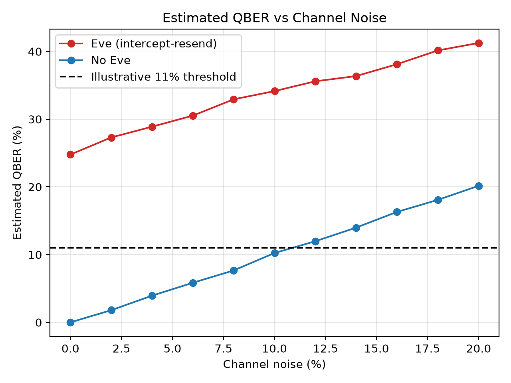
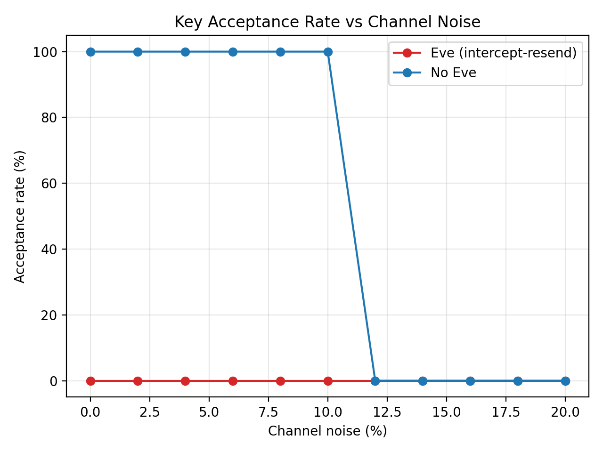
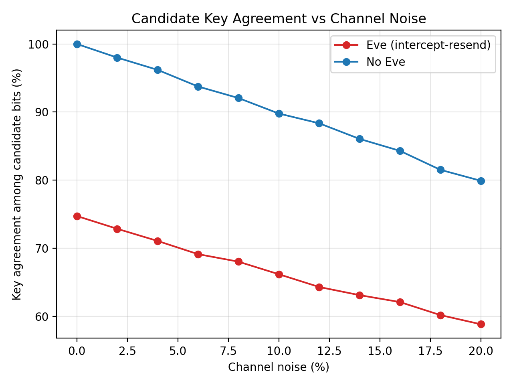
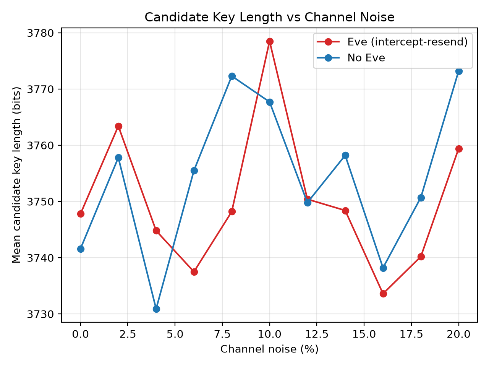
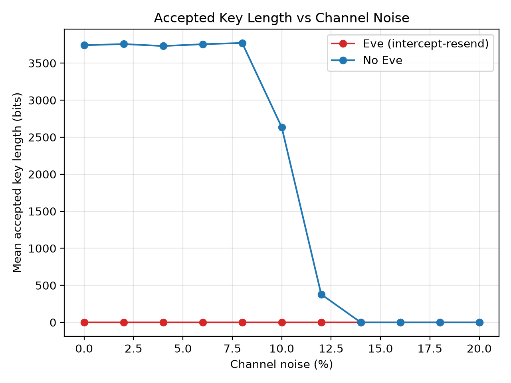
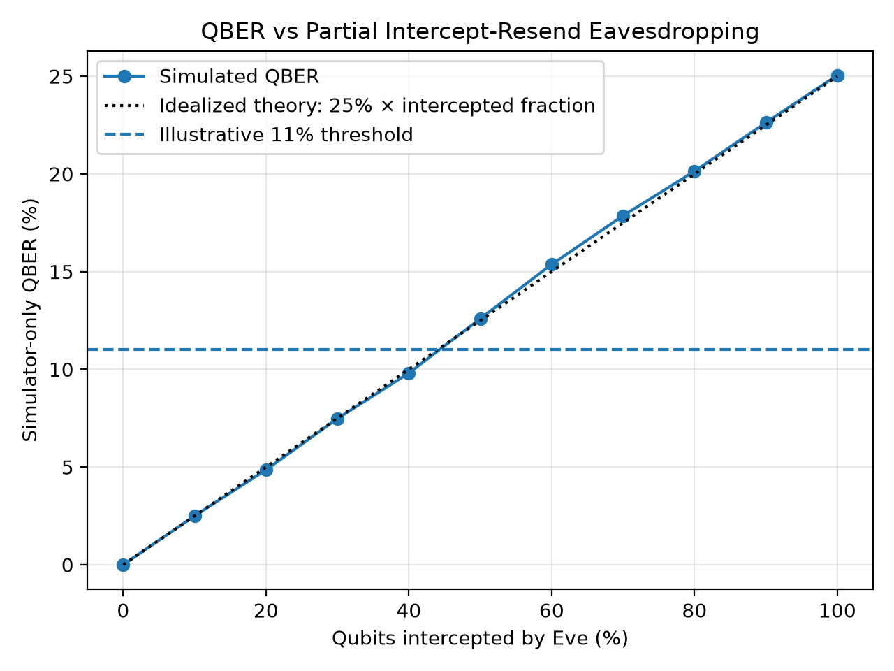

# Performance Analysis of BB84 Quantum Key Distribution under Noise and Eavesdropping using Qiskit

**IEG 313: Quantum Computing for Engineers: Theory and Applications**, IIIT Kottayam
**Team:** Bell State Bandits

A Qiskit simulation of the **BB84 quantum key distribution protocol**. It measures how channel noise (0 to 20%) and an intercept-resend eavesdropper (Eve) change the **Quantum Bit Error Rate (QBER)**, key agreement and key length, and includes a **QBER-threshold detector** that accepts or rejects the key.

## Team
| Name | Roll No. |
|---|---|
| C. Nitesh Kumar (Leader) | 2024BCS0270 |
| J. Nandan | 2024BCS0190 |
| R. Mourya Reddy | 2024BCS0307 |
| Himanshu | 2024BCS0286 |
| S. Sameer Basha | 2024BCS0290 |

## How BB84 works
1. **Alice** picks random bits and random bases (Z or X) and sends the qubits.
2. **Bob** measures each qubit in a randomly chosen basis.
3. **Sifting:** over a public channel they compare *bases only* and keep positions where the bases matched (about 50%).
4. **QBER estimation:** they reveal a random sample (25%) of the sifted bits. The mismatch rate is the QBER. Revealed bits are discarded.
5. **Detector:** estimated QBER <= 11% means **accept** (the remaining bits are the candidate key). QBER > 11% means **reject**.

Measuring a qubit in the wrong basis gives a random result and disturbs it, so an eavesdropper leaves errors behind. An **intercept-resend** attack gives about **25% QBER**.

| Basis | bit 0 | bit 1 |
|---|---|---|
| Z (0) | &#124;0&#10217; | &#124;1&#10217; |
| X (1) | &#124;+&#10217; | &#124;-&#10217; |

## What is simulated
| Component | Implementation |
|---|---|
| Qubit preparation / measurement | 1-qubit Qiskit circuits (X gate for the bit, H gate for the X basis) |
| Channel noise | Depolarizing error in Qiskit Aer, scaled so noise % = bit-flip probability per channel segment |
| Eve | Intercept-resend: measures in a random basis, resends what she read. Can intercept all or only a fraction of the qubits |
| Sifting, QBER, detector | NumPy (`run_bb84` in `bb84_qkd.py`) |
| Confidence interval | Approximate 95% interval on the QBER estimate, reported for every run |
| Experiments and plots | pandas and Matplotlib |

**Defaults:** 10,000 qubits per run, 25% of the sifted key used as the QBER sample, 11% threshold, 10 trials per setting.

> **Noise note:** noise is applied on every channel segment a qubit crosses. With Eve present, the qubit crosses two noisy segments (Alice to Eve, Eve to Bob), so at the same noise label the Eve scenario has more total noise than the no-Eve scenario.

## Repository structure
```
bb84-qkd-qiskit/
├── bb84_qkd.py        # all the simulation code
├── BB84_QKD.ipynb     # notebook version for demos
├── requirements.txt
├── results/           # CSVs and graphs produced by the experiments
└── README.md
```

## Setup and run
```bash
pip install -r requirements.txt

python bb84_qkd.py --demo --seed 1   # one verbose run, with and without Eve
python bb84_qkd.py                   # full experiments -> results/
```
Or open `BB84_QKD.ipynb` in Jupyter and use **Run All**.

## Results (10,000 qubits per run, 10 trials per setting)

### Channel noise, no Eve
| Noise | Estimated QBER | Key accepted |
|---|---|---|
| 0% | 0.0% | 100% |
| 2% | 1.8% | 100% |
| 4% | 3.9% | 100% |
| 6% | 5.9% | 100% |
| 8% | 7.7% | 100% |
| 10% | 10.2% | 70% |
| 12% | 12.0% | 10% |
| 14% to 20% | 14.0% to 20.2% | 0% |

The QBER is almost exactly the noise level. The detector flips from accept to reject around 10 to 12% noise, which is where the 11% threshold sits.

### Intercept-resend Eve (intercepts every qubit)
| Noise | Estimated QBER | Key accepted |
|---|---|---|
| 0% | 24.8% | 0% |
| 4% | 28.9% | 0% |
| 10% | 34.2% | 0% |
| 20% | 41.3% | 0% |

With no noise, Eve causes **24.8% QBER**, matching the theoretical 25% (she guesses the wrong basis half the time, and then Bob errs half the time). The key is rejected in every case.

### Partial eavesdropping (Eve intercepts a fraction f, no noise)
| Fraction intercepted | True QBER | Key accepted |
|---|---|---|
| 10% | 2.5% | 100% |
| 20% | 4.9% | 100% |
| 30% | 7.5% | 100% |
| 40% | 9.8% | 100% |
| 50% | 12.6% | 0% |
| 70% | 17.9% | 0% |
| 100% | 25.1% | 0% |

QBER is about 25% x f. An eavesdropper who intercepts less than roughly 40 to 45% of the qubits stays **below the 11% threshold and is not detected**.

### Graphs


| | |
|---|---|
|  |  |
|  |  |



## Key takeaways
- Eve's intercept-resend attack raises the QBER to about 25%, matching the theory.
- Channel noise raises the QBER roughly one-to-one with the noise level.
- BB84 **cannot tell noise from eavesdropping**: both raise the QBER and the key is aborted.
- A partial eavesdropper (below about 40% interception) can stay under the threshold, which is why real systems add privacy amplification.
- The candidate key is about **37.5% of the qubits sent** (50% survive sifting, then 25% of those are spent on the QBER sample). The accepted key length is 0 whenever the key is rejected.
- With 10,000 qubits the sample-based QBER estimate agrees with the true QBER to within about 0.5 percentage points.

## Limitations and future work
- The "accepted key length" is a teaching metric, not a secure final key: there is no error correction (e.g. Cascade) or privacy amplification.
- Only intercept-resend attacks are simulated, not photon-number-splitting or other attacks.
- Noise is a simple depolarizing model, not a full hardware model.

## References
1. C. H. Bennett and G. Brassard, "Quantum cryptography: Public key distribution and coin tossing," *Proc. IEEE Int. Conf. Computers, Systems and Signal Processing*, Bangalore, India, 1984, pp. 175-179.
2. M.-Z. Mina and E. Simion, "A Scalable Simulation of the BB84 Protocol Involving Eavesdropping," *Cryptology ePrint Archive*, Paper 2020/1074, 2020.